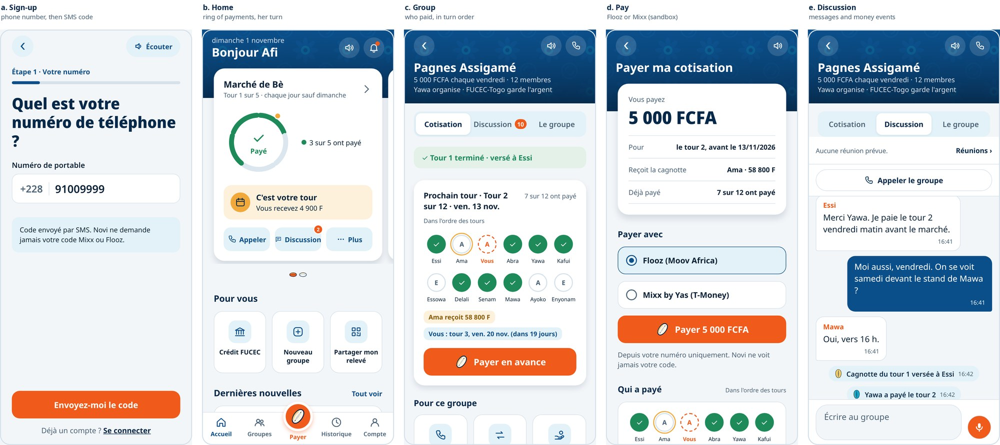

# Novi

Novi is a digital tontine for women informal traders in Lomé, Togo. A group of traders saves together on a fixed rhythm (for example 5 000 FCFA every Friday, or 1 000 FCFA every market day), and at each round one member receives the whole pot. **Novi never holds the money**: each group's savings sit in an account at a licensed microfinance institution (FUCEC-Togo in the pilot). Novi applies the group's rules, shows every member the same record, and instructs the institution when a pot is due. Each member's payment history becomes a signed record that a lender can trust, and the path to a microloan.

> Mission: increase access to safe savings and formal credit for women informal traders in Lomé, Togo, by building a digital tontine that keeps their group savings with a licensed microfinance institution and turns their payment history into a record lenders can trust.

Capstone project, BSc Software Engineering, African Leadership University (2026). Supervisor: Emmanuel Annor.

| | |
| --- | --- |
| Walkthrough video | https://drive.google.com/file/d/14VB0Iwb2AAfy9Imy48L39sAIw1N0srCe/view?usp=sharing_ |
| Technical report (PDF) https://drive.google.com/file/d/1xnoM5nkKuPxni25QNK2243s2GlWd5ZQy/view?usp=sharing
| Live API | https://novi-api-w7ri.onrender.com/health |
| MFI console (live) | https://novi-api-w7ri.onrender.com/console/ |
| Decision log | [docs/decisions.md](docs/decisions.md) (D1 to D94) |
| Test results | [docs/testing.md](docs/testing.md) |



More screens: [MFI console](docs/screenshots/console.jpg) · [statement, credit and errors](docs/screenshots/app-record-credit-errors.jpg) · [USSD](docs/screenshots/ussd.jpg)

## What it does

**For a member (mobile app, French, English, Ewe):**
- Sign up with her phone number, an SMS code, an identity check against the national ID register (mocked: ANID has no public API) and a 4-digit PIN.
- Create a group (daily, weekly or monthly; 3 to 15 members), invite members by phone number, agree the rules, and start once the MFI has validated it.
- Pay her contribution by mobile money (Flooz or Mixx by Yas, through FedaPay's sandbox), inside the app, and see the round fill up as a ring of members.
- Receive the pot at her turn, released by the MFI officer, and confirm she received it.
- Chat, send voice notes, call the group or hold a meeting inside the app.
- Swap her turn, ask the group's solidarity fund for a small advance, and request a microloan under the MFI's own conditions, with her documents sent as photos.
- See her statement and share a signed savings record (ACEV) with a lender.
- Reach the essentials by **USSD** on any phone, without internet.

**For the MFI (web console, French and English):**
- One "to do" list: groups to validate (with each member's record, by consent), pots to release, disputes, failed transfers, advances to send, loan requests.
- Each group's money (collected, paid out, balance, solidarity reserve) and rounds.
- Credit conditions set by the MFI, document review, and the decision recorded after the agency visit.
- A journal of every officer action, team management, and email alerts outside the console.

## Architecture

```
 Phone app (Expo)  ──┐
 Basic phone (USSD) ─┼──► API (Express, TypeScript) ──► PostgreSQL (Prisma)
 MFI console (React)─┘          │
                                └──► providers: identity · SMS · payment (FedaPay)
                                     · MFI · meetings (Daily) · push · email (Brevo)
```

- **Layers:** `routes` (who is asking, is the request well formed: Zod) → `services` (the business rules) → `providers` (the outside world) and Prisma (the database).
- **Every outside service sits behind an interface** (`IdentityProvider`, `SmsProvider`, `PaymentProvider`, `MfiAdapter`, `MeetingProvider`, `PushProvider`, `EmailProvider`), with a real and a mock implementation chosen in one file, `apps/api/src/providers/index.ts` (D3).
- **Money is stored as whole FCFA**, and the ledger is **append-only**, enforced by a database trigger (D4, D46).
- **Shared types** between the API, the app and the console live in `packages/shared`, so a change in one breaks the build of the others instead of failing at runtime.

## Technical requirements

| Component | Version |
| --- | --- |
| Node.js | 24 or later (`engines` in `package.json`) |
| npm | 10 or later (workspaces) |
| PostgreSQL | 16 or later (18 used in development) |
| API | Express 5.3, Prisma 7.10.0 (pinned), Zod 3.25, TypeScript 7 |
| Mobile app | Expo SDK 58, React Native 0.88, React 19.3, Expo Router 58, i18next 26 |
| Console | React 19.3, Vite 8 |
| Tests | Vitest 5, Supertest |
| Phones | Android and iOS versions supported by Expo SDK 58 (see Expo's documentation); USSD on any GSM phone |
| Console browsers | Current Chrome, Edge, Firefox, Safari |
| Hosting | Render (Docker image of the API and console, managed PostgreSQL) |

## Installation (local)

```bash
git clone https://github.com/estheredi0406/novi-app.git
cd novi-app
npm install
```

1. **Database.** Create two PostgreSQL databases, `novi_dev` and `novi_test`, owned by a dedicated user (D8).
2. **Environment.** Copy `apps/api/.env.example` to `apps/api/.env` (and `.env.test` for tests) and fill in the values. Secrets are never committed (D14). Without provider keys, every outside service uses its mock.
3. **Schema.**
   ```bash
   cd apps/api && npx prisma migrate dev && cd ../..
   ```
4. **Run the API** (port 3000):
   ```bash
   npm run dev:api
   ```
5. **Run the console** (port 5173, forwards `/v1` to the API):
   ```bash
   npm run dev:console
   ```
6. **Run the app.** In `apps/mobile/.env`, set `EXPO_PUBLIC_API_URL=http://<your laptop's IP>:3000`, then:
   ```bash
   npm run dev:mobile
   ```
   Scan the QR code with Expo Go (iPhone) or install the Android build (`eas build --platform android --profile preview`). In-app calls, in-app payment and document photos need the installed build.
7. **First MFI administrator** (once):
   ```bash
   cd apps/api && npm run staff:create -- FUCEC admin@example.org "Full Name" ADMIN
   ```

Test identities for the mock ID check are listed in `docs/test-identities.md`.

## Tests

```bash
npm test                 # builds the shared package, then runs every workspace's tests
cd apps/api && npx vitest run src/test/money.test.ts   # one area
```

- **API:** unit tests for the rules (`src/lib/*.test.ts`: rules engine, calendar, streak, PIN rules, hashing, TOTP) and integration tests that drive the real HTTP endpoints against a separate `novi_test` database (`src/test/*.test.ts`). A guard refuses to run against any other database.
- **App:** unit tests for the pure logic (formatting, rules text, which round the Payer button opens, reading the ID card barcode): `cd apps/mobile && npm test`.
- Results, load test (50 and 100 users), console checks at five screen sizes and app size: [docs/testing.md](docs/testing.md). Scripts: `tools/perf/`.

## Deployment

The API and the console are one Docker image (`Dockerfile`) deployed on Render with a managed PostgreSQL database (`render.yaml`, D58, D60). Every push to `main` deploys again, and each start applies pending migrations (`prisma migrate deploy`). Step by step: [docs/deploy.md](docs/deploy.md).

The app is published with EAS: `eas build --platform android --profile preview` for an installable APK, `eas update --channel preview` for JavaScript-only updates (run from `apps/mobile`).

Partner MFIs (D95): `npm run mfi:create -- DEMO "MFI de démonstration"` adds an MFI that groups can choose; then `npm run staff:create -- DEMO admin@example.org "Full Name" ADMIN` opens its first console account.

Pilot-only commands, run from Render's shell: `npm run demo:payout -- "Group"` (treat the next round as due today), `npm run demo:reset` (start again from zero groups, keeping the accounts).

## Repository structure

```
novi-app/
├── apps/
│   ├── api/                  Express API (also serves the console at /console)
│   │   ├── prisma/           schema.prisma and migrations
│   │   └── src/
│   │       ├── routes/       HTTP endpoints: auth, me, groups, contributions, console, staff, ussd, webhooks, verify
│   │       ├── services/     business rules, one file per area (groups, money, payouts, reserve, loans, alerts…)
│   │       ├── providers/    interfaces and their real and mock implementations
│   │       ├── lib/          pure logic: rules engine, calendar, streak, hashing, tokens, TOTP, signing
│   │       ├── middleware/   authentication of members and staff, error handling
│   │       ├── scripts/      server commands (staff creation, demo tools)
│   │       └── test/         integration tests, one file per area
│   ├── mobile/               Expo app
│   │   └── src/
│   │       ├── app/          screens (Expo Router): sign-up, home, groups, payment, loan, record…
│   │       ├── components/   reusable UI (cards, ring of members, bottom bar, sheets)
│   │       ├── api/          typed calls to the API
│   │       ├── lib/          formatting, rules text, notifications, calls, photos
│   │       ├── i18n/         en, fr, ee
│   │       └── theme/        colours and type
│   └── console/              React + Vite MFI console (pages, texts in French and English)
├── packages/shared/          types, error codes and PIN rules shared by the three apps
├── docs/                     decisions.md, deploy.md, testing.md, Ewe sentences, test identities
├── tools/perf/               load test and console compatibility scripts
├── Dockerfile, render.yaml   hosting
└── package.json              npm workspaces
```

## Status and scope

Built: F1 to F11, F14, F16 and F17 of the original plan, plus the features added after the supervisor's reviews (MFI validation with consent, released pots and receipts, solidarity fund and advances, turn swaps, loan requests with documents, calls and payment inside the app, officer emails, daily groups). Deferred, with reasons and replacements: the carnet, three-way reconciliation, offline sync, the AI assistant and the agency map ([D94](docs/decisions.md)). Still mocked: SMS, the ANID check and the MFI's own systems (no public APIs); payments use FedaPay's sandbox.

## Author

Esther Sessenou, African Leadership University, Kigali.
